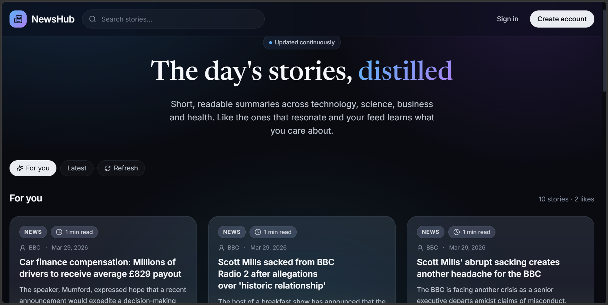

# NewsHub

The frontend for my News Summarization Project. NewsHub turns the day's stories into short, readable summaries across technology, science, business and health. Like the stories that resonate and the **For you** feed learns what you care about, or switch to **Latest** for the newest summaries.

## Features
```
❤️ Single Page App
🤩 Smooth animations
❤️ React Context API
```

## Tech Stack
React
Tailwind CSS

## Screenshot



## Run Locally
Clone the repo  
```
npm install  
npm run dev  
```

I suck at UI design so I bootstrapped from [Lovable](https://lovable.dev/).
